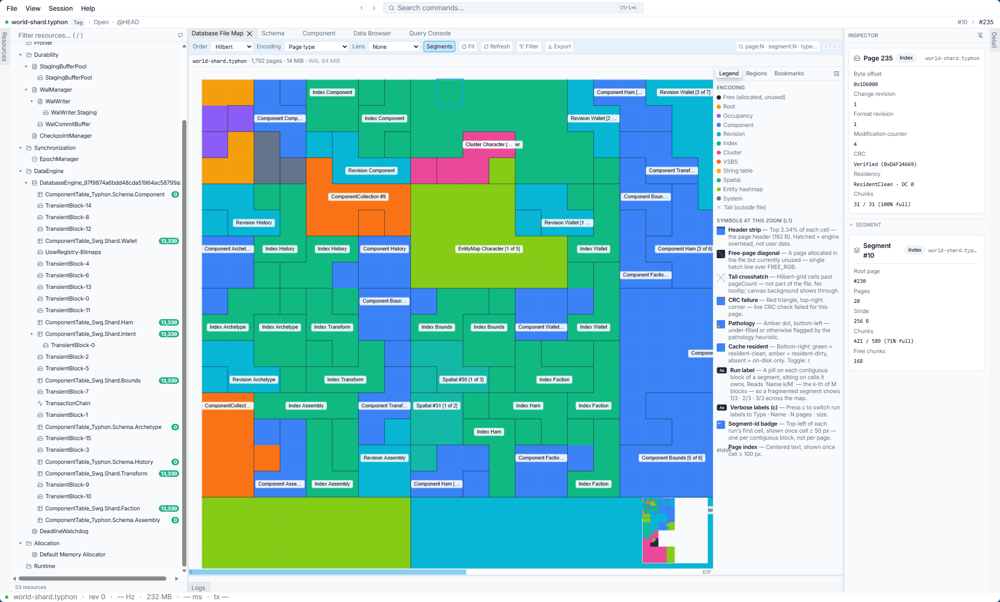
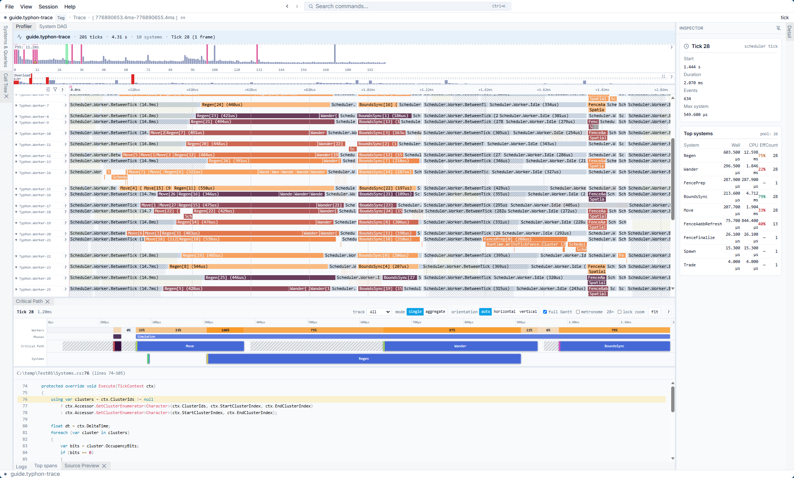

# Typhon

[](https://github.com/Log2n-io/Typhon/actions/workflows/merge-gate.yml)
[](https://github.com/Log2n-io/Typhon/actions/workflows/build-docs.yml)
[](LICENSE.md)
[](https://dotnet.microsoft.com/)
[](https://doc.typhondb.io)
[](https://github.com/Log2n-io/Typhon/releases)
<br/>
**Server** ·
[](https://www.nuget.org/packages/Typhon)
[](https://www.nuget.org/packages/Typhon.Cli)
[](https://www.nuget.org/packages/Typhon.Subscriptions.AspNetCore)
<br/>
**Clients** ·
[](https://www.nuget.org/packages/Typhon.Client)
[](https://www.nuget.org/packages/Typhon.Protocol)
[](https://www.npmjs.com/package/@typhondb/client)
[](https://github.com/Log2n-io/Typhon/releases)

### 📣 10 slides, 4 minutes to understand what it is about ➡️ [Typhon intro](https://www.typhondb.io/deck/typhon-intro).

#### Want to learn more, read the [**pitch**](PITCH.md).
It makes the case for Typhon — the problem it solves, what's actually built and measured today, and where it's headed — before you dive into the technical docs below.

### ⚠️ Alpha — `1.0.0-alpha.1` is out. ⚠️
The features are in; what remains is polish, user feedback and stabilizing. Not yet production-ready, but ready for POC & early adopters.

**The [engine](https://www.nuget.org/packages/Typhon)**, the **[CLI + Workbench](https://www.nuget.org/packages/Typhon.Cli)**, **[ASP.NET Core hosting](https://www.nuget.org/packages/Typhon.Subscriptions.AspNetCore)**
and the **Subscriptions client SDKs** — [.NET & Unity](https://www.nuget.org/packages/Typhon.Client), [TypeScript](https://www.npmjs.com/package/@typhondb/client) and
[C](https://github.com/Log2n-io/Typhon/releases) — all ship at one version; see **[every package](https://doc.typhondb.io/latest/guides/packages.html)**. Full **[reference documentation](https://doc.typhondb.io)** is live. The line runs alpha → beta (public API and wire protocol frozen) → rc → 1.0.0, prerelease-only until then. **[Open an issue](https://github.com/Log2n-io/Typhon/issues)** or go to the **[discussions](https://github.com/Log2n-io/Typhon/discussions)** for help, questions, or feedback.


**A real-time world engine: an ACID, larger-than-RAM ECS store, a parallel tick runtime, spatial partitioning with realms, and interest-managed replication to .NET/Unity, TypeScript and native C clients — one process, one data model, from disk to screen.**

Typhon started as an embedded ECS database and grew upward, one layer at a time. Each layer runs inside the engine, on the same entities,
transactions and snapshots as the one below it: the runtime doesn't sit on top of the database — it runs inside it — and replication streams
what the tick just wrote, with no second data model in between.

```text
┌──────────────────────────────────────────────────────────────────────────┐
│ Clients       .NET & Unity  ·  TypeScript  ·  C / FFI                    │
└──────────────────────────────────────────────────────────────────────────┘
                    ▲  TCP / WebSocket, typhon.3 wire
┌──────────────────────────────────────────────────────────────────────────┐
│ Replication   what each archetype exposes, who sees what,                │
│               commands & events, per-session budgets                     │
│ World         spatial partitioning (per-realm cell grid) · realms        │
│ Runtime       tick loop · DAG scheduler · parallel systems               │
│ Store         ECS archetypes · MVCC ACID transactions · indexes, queries │
│               WAL & crash recovery · paged, larger than RAM              │
└──────────────────────────────────────────────────────────────────────────┘
      one process · one data model · the same entities, transactions
      and snapshots at every layer
```

📖 **Start here:**
- **[📚 doc.typhondb.io](https://doc.typhondb.io)** — the new documentation site: guide, in-depth overview, feature catalog, and full **API reference**, all in one browsable, searchable place.
- **[User Guide](https://doc.typhondb.io/latest/guides/README.html)** — learn the key concepts hands-on, backed by a small **runnable sample project** ([`doc/guide/example`](doc/guide/example)).
- **[In-Depth Overview](https://doc.typhondb.io/latest/overview/README.html)** — dig into how every subsystem works, and the reasoning behind it.
- **[Packages](https://doc.typhondb.io/latest/guides/packages.html)** — every NuGet, npm and native package, what each is for, and which ones you need.
- **Demos** — [Asteroid Field](demo/AsteroidField) (a Unity 6 client on the netstandard2.1 SDK) and [AntHill](https://doc.typhondb.io/latest/demos/anthill.html) (a persistent world larger than RAM).

🗺️ **Curious what's next?** Current priorities, in-progress work, and the roadmap are tracked live on the [GitHub Project](https://github.com/orgs/Log2n-io/projects/1/views/1).

---

## Key Features

📚 This is a curated highlight reel — see the full **[Feature Catalog](https://doc.typhondb.io/latest/guides/feature-catalog/README.html)** for every capability, categorized and cross-linked to source and tests.

### 🗄️ Store — an ACID ECS database

- **Microsecond Operations** — Optimized for µs-level latency with pinned memory, SIMD, and lock-free reads
- **ACID Transactions** — Full transactional semantics with optimistic concurrency control
- **MVCC Snapshot Isolation** — Readers never block writers; each transaction sees a consistent snapshot
- **ECS Archetype System** — Entities are typed by archetype; components are blittable structs with source-generated accessors and archetype inheritance
- **Entity Clusters** — SoA batched storage co-locating up to 64 entities per cluster, with cluster-native SIMD predicate evaluation (AVX-512 / AVX2 / scalar dispatch), zone-map pruning, and k-way sorted merge
- **Three Storage Modes** — Versioned (full MVCC + WAL), SingleVersion (last-writer-wins; per-tx TickFence or **Committed** durability discipline — atomic, zero-loss, no revision chain), Transient (heap-only, no persistence)
- **Larger-Than-RAM Storage** — The database is a paged file on disk, virtualized through the engine's own native page cache that holds only the hot working set — so resident memory is bounded by the cache, not the database. Manipulate a 100 GiB store on a machine with a fraction of that RAM; component data, indexes, and the entity map all page to/from disk on demand (in-memory ECS frameworks, by contrast, must fit the entire world in RAM)
- **Entity Relationships** — Typed `EntityLink<T>` references for 1:1, 1:N, and N:M relationships, with declarative cascade delete and reactive FK-joined queries
- **Schema Versioning** — Component/field-level revisions with migration functions, compatible-evolution support, and audit history; automatic archetype layout-drift detection at database open is still landing
- **Bulk Load Session** — Opt-in exclusive write path for fast dataset ingestion, batching writes through a recycled Transaction and committing the whole load atomically behind a checkpoint barrier

### 🔎 Queries & Indexes

- **Query Engine** — Typed queries with `Where`, `With`/`Without` filters, polymorphic iteration, OR logic, navigation joins, and a cluster execution path that routes filtered scans through SIMD gather-compare on cluster SoA columns
- **Views & Change Tracking** — Incremental entity-set monitoring (added/removed/modified detection) via ring-buffer delta streaming for indexed queries — opaque/unindexed predicates still work but fall back to a full re-scan per refresh; SingleVersion/Transient view support is still being validated end-to-end
- **B+Tree Indexes** — Cache-aligned 256-byte nodes with optimistic lock coupling and specialized key-size variants

### 💾 Durability & Integrity

- **Write-Ahead Logging** — WAL (v2, always on) with configurable durability modes (Deferred, GroupCommit, Immediate) and coalesced tick-boundary snapshots via `TickFence` / `ClusterTickFence` chunks for the runtime tick loop
- **Configurable Durability** — Choose per-UnitOfWork whether data is deferred, group-committed, or immediately fsynced
- **Page Integrity** — CRC32C checksums, suspect-page detection, and crash-recovery rebuild (index + EntityMap); full-page images were retired in favor of a rebuild-based torn-page net. Recovery runs only after an unclean close, and works on databases larger than the page cache
- **Integrity Check & Repair** — `typhon check` reads a database as bytes, with no engine — so it diagnoses one that will not open — runs every cross-structure check, reports as text or JSON and carries the verdict in its exit code; `typhon repair --plan` / `--apply` rebuilds derived structures, reclaims leaked pages and restores A/B page pairs, and asks before anything that would lose data

### ⚙️ Runtime — the simulation

- **Tick-Based Parallel Runtime** — Tick-based micro-task `DagScheduler` with any-worker parallel dispatch, per-system change filters, parallel chunks that write Versioned data and spawn/destroy entities (`ctx.Commands`), typed MPSC event queues, side-transactions, cluster dormancy with staggered heartbeat wake, checkerboard Red/Black dispatch, and a growing overload response ladder (system throttling, tick-rate modulation up to 6x, a last-resort player-shedding callback) — still evolving, with finer-grained escalation designed but not a current priority

### 🌍 World — space and realms

- **Spatial Indexing** — A declarative `[SpatialIndex]` on any component field, answered by one index: a sparse 2D/3D cell grid per realm locates the cells, a per-cell cluster broadphase answers AABB / Radius / Ray / Frustum / kNN queries (SIMD narrowphase, category masks), with multi-resolution `SimTier` dispatch for near/far/coarse simulation budgets
- **Realms** — Several isolated worlds (planets, interiors, space, instanced dungeons) hosted by one engine: each realm owns its grid and cell size, is queried and replicated on its own, and can sleep or run at a reduced rate while nobody watches it

### 📡 Replication — the bridge to clients

- **Subscriptions (push replication)** — Engine-owned replication to remote clients: declare what each archetype exposes (`[Replicated]`, `[Motion]`, `[Owner]`…) and the engine does change detection, quantized encoding, motion segments, per-session visibility (sphere / region / distance bands, groups, visibility tags), typed commands, best-effort or reliable events, session resume and per-session byte budgets — in parallel on the worker pool, over TCP or WebSocket (ASP.NET Core), on the catalog-driven `typhon.3` wire
- **Client SDKs** — .NET (`Typhon.Client`, also netstandard2.1 for **Unity**), TypeScript (`@typhondb/client`, browser + Node) and C (a C ABI with a CMake package, for native clients and FFI bindings): a columnar world store, motion extrapolation, commands, groups, events and reconnection, all decoding against the server's catalog

### 🧰 Tooling

- **Workbench Dev UI** — **📣[Demo video #1](https://www.youtube.com/watch?v=yIFqwPJKOlA)📣** A local, browser-based companion (ASP.NET Core + React/Vite) — *DataGrip for Typhon*, not just a profiler. Open a recorded `.typhon-trace`, attach to a live engine over TCP, or open a `.typhon` database file directly. **Performance:** per-tick profiler timeline with CPU-sample + off-CPU overlays, Top Spans, Call Tree, Critical Path, System DAG. **Data & schema:** component/archetype browsers, Schema Inspector, a zoomable Hilbert-curve Database File Map, live Resource Tree. **Queries:** catalog, plan tree, per-execution inspector — all in a dockable, persisted workspace
- **Deep-Trace Profiler** — Per-tick Gantt and flame-graph visualization via a `.typhon-trace` binary format, live TCP streaming to a React/Vite viewer, and optional `dotnet-trace` CPU sampling correlation for full managed-stack profiles
- **Observability** — Runtime telemetry, metrics, and diagnostics with zero-cost JIT-eliminated toggles
- **CLI (`typhon`)** — Database REPL and `.tsh` script runner, `typhon new` project scaffolding, `check` / `repair`, and the launcher for the Workbench (`typhon ui`)
- **Public/Internal API split** — Two namespaces per assembly (`Typhon.Engine` / `Typhon.Engine.Internals`), each subsystem folder split into `public/` + `internals/`, enforced at compile time by the `TYPHON008` Roslyn analyzer
- **Roslyn Analyzers** — Custom analyzers detecting undisposed engine resources at compile time + the `TYPHON008` internal-API leak detector

## Quick Start

A taste — declare a component and an archetype, spawn an entity, read it back:

```csharp
// A component is a plain struct; an archetype is the fixed set of components an entity has.
[Component("Game.Health", 1, StorageMode = StorageMode.Versioned)]
public struct Health { public int Current, Max; }

[Archetype(1)]
public sealed partial class Unit : Archetype<Unit>
{
    public static readonly Comp<Health> Health = Register<Health>();
}

// ...build the engine + register the schema (see the Guide), then:
using var tx = dbe.CreateQuickTransaction();
var id = tx.Spawn<Unit>(Unit.Health.Set(new Health { Current = 100, Max = 100 }));
var hp = tx.Open(id).Read(Unit.Health);   // hp.Current == 100
tx.Commit();
```

> *Illustrative — engine build + schema registration are elided. The **[User Guide](https://doc.typhondb.io/latest/guides/README.html)** has the full, **runnable** version ([`doc/guide/example`](doc/guide/example)).*

### A 5 minutes round-trip
Install the [Typhon.Cli](https://www.nuget.org/packages/Typhon.Cli) NuGet package and follow the [instructions](src/Typhon.Shell/PACKAGE.md) to create a sample app, run it, profile it, open the database and the profiled session in the workbench.

Workbench Database


Workbench Profile viewer


## Status

Typhon is in **alpha** (`1.0.0-alpha.1`): the features are in, stabilization is under way. What changed in each version is in the
[releases](https://github.com/Log2n-io/Typhon/releases); what's next is on the [GitHub Project](https://github.com/orgs/Log2n-io/projects/1/views/1).

**Not yet:**
- Backup and restore — point-in-time incremental backup is designed, not built
- TLS and WebSocket in the native client SDK — it speaks plain TCP today
- Spreading one world across several machines — one engine runs in one process; realms divide worlds inside it
