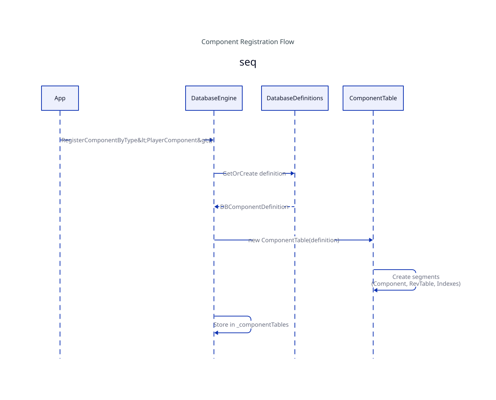

# 04 — Schema

**Code:** [`src/Typhon.Engine/Schema/`](https://github.com/Log2n-io/Typhon/tree/main/src/Typhon.Engine/Schema) + sibling project [`src/Typhon.Schema.Definition/`](https://github.com/Log2n-io/Typhon/tree/main/src/Typhon.Schema.Definition)

Typhon is **schema-first**. Every component you store has a declared structure — fields, types, offsets, indexes — and that structure is persisted alongside the data. When you reopen a database, the engine reads the persisted schema, compares it to the runtime structs you've registered, and either accepts the match, evolves the layout in place, or refuses to open. There is no untyped storage and no "schemaless" fast path.

This document covers what a component schema looks like, where it lives on disk, how registration works at startup, and how the engine handles schema evolution (added/removed/widened/migrated fields) on reopen.

<a href="assets/typhon-data-registration-flow.svg">
  
</a>
<br>
<sub>Component registration flow: <code>RegisterComponentByType&lt;T&gt;()</code> → <code>DatabaseDefinitions</code> get-or-create the <code>DBComponentDefinition</code> → construct the <code>ComponentTable</code> → create its segments (Component / RevTable / indexes) → store in the engine's table map.</sub>

---

## 1. Overview — schema-first by design

Three principles drive the design:

1. **Every component is declared.** The struct's C# definition (`[Component]`, `[Field]`, `[Index]`, `[SpatialIndex]`, `[ForeignKey]`) is the runtime source of truth. The engine reflects over the struct at registration time to build a `DBComponentDefinition`.
2. **Every component is persisted.** The schema itself is stored in the database — as **system components** (`ComponentR1`, `FieldR1`, `ArchetypeR1`, `SchemaHistoryR1`) — using the same `ComponentTable` machinery that user components use. Schema *is* data, just system data.
3. **Schema evolution is eager, not lazy.** When you reopen a database with a changed C# definition, the engine resolves the difference *before* WAL replay begins. By the time application code is allowed to write, the on-disk layout already matches the runtime layout. There is no per-read fixup, no shadow field map at query time.

The user-facing types — `FieldType`, `[Component]`, `[Field]`, `String64`, `Variant`, spatial primitives — live in a sibling project [`Typhon.Schema.Definition`](https://github.com/Log2n-io/Typhon/tree/main/src/Typhon.Schema.Definition) so that codegen, tooling, and external consumers can reference the schema vocabulary without pulling in the full engine. See [01-foundation §9](01-foundation.md) for the full list.

---

## 2. Component / field model

### `FieldType` enum

[`Typhon.Schema.Definition/FieldType.cs`](https://github.com/Log2n-io/Typhon/blob/main/src/Typhon.Schema.Definition/FieldType.cs)

The closed set of types Typhon understands for a component field. It's a `[Flags]` enum, but only two flag bits are mixed with the base values — `Unsigned` (256) and `DoubleFloat` (512) — so each combination still names exactly one storage kind.

| Group | Members |
|---|---|
| Boolean / numeric | `Boolean`, `Byte`, `Short`, `Int`, `Long`, `Float`, `Char` |
| Unsigned (= `Unsigned \| base`) | `UByte`, `UShort`, `UInt`, `ULong` |
| Double-precision (= `DoubleFloat \| base`) | `Double` (= `DoubleFloat \| Float`), `Point2D/3D/4D`, `QuaternionD`, `AABB2D/3D`, `BSphere2D/3D` |
| Strings | `String64` (fixed 64 B), `String1024` (fixed 1024 B), `String` (variable — 32 B inline + VSB overflow), `Variant` (tagged-union, stored as String64) |
| Points / quaternions (float) | `Point2F`, `Point3F`, `Point4F`, `QuaternionF` |
| Spatial boxes & spheres (float) | `AABB2F`, `AABB3F`, `BSphere2F`, `BSphere3F` |
| Spatial boxes & spheres (double) | `AABB2D`, `AABB3D`, `BSphere2D`, `BSphere3D` |
| References | `Component` (8-byte reference), `Collection` (= `ComponentCollection<T>`, 4-byte handle) |
| Modifier flags | `Unsigned = 256`, `DoubleFloat = 512` |

Modifier bits keep the relationship explicit: `Double` *is* `DoubleFloat | Float`, `AABB3D` *is* `DoubleFloat | AABB3F`. The widening engine ([§4](#4-schema-evolution)) uses these relationships directly.

`DatabaseSchemaExtensions.FromType<T>()` maps a CLR type to `(FieldType, underlyingType)`. `FieldSizeInComp()` returns the on-component byte width — e.g. `Point3F` → 12, `AABB3D` → 48, `Variant` → 64 (it's a `String64` under the hood). Variable-width `String` reports 32 (the inline portion); the overflow lives in a variable-sized buffer segment.

### `DBComponentDefinition` and `Field`

[`Schema/public/DBComponentDefinition.cs`](https://github.com/Log2n-io/Typhon/blob/main/src/Typhon.Engine/Schema/public/DBComponentDefinition.cs)

The runtime descriptor for one revision of one component. Built by `DatabaseDefinitions.CreateFromAccessor<T>()` via reflection over the struct's public fields.

```csharp
public class DBComponentDefinition
{
    public string Name { get; }
    public int Revision { get; }
    public bool AllowMultiple { get; }
    public StorageMode StorageMode { get; }   // Versioned / SingleVersion / Transient
    public IReadOnlyDictionary<string, Field> FieldsByName { get; }
    public int MaxFieldId { get; }
    public int ComponentStorageSize { get; }            // bytes of payload
    public int ComponentStorageOverhead { get; }        // entityPK + AllowMultiple index entries
    public int ComponentStorageTotalSize => ComponentStorageSize + ComponentStorageOverhead;
    public int EntityPKOverheadSize { get; }            // 8 for SV/Transient, 0 for Versioned
    public int IndicesCount { get; }
    public int MultipleIndicesCount { get; }
    public Field SpatialField { get; }                  // null if none
}
```

`FullName` is `"<Name>:R<Revision>"` — name + revision identify a schema slot uniquely. Same name + different revision = different schema slot.

`Field` carries everything a writer or reader needs at runtime:

```csharp
public class Field
{
    public int FieldId { get; }                     // stable across reopens, resolved by FieldIdResolver
    public string Name { get; }
    public FieldType Type { get; }
    public FieldType UnderlyingType { get; }
    public int OffsetInComponentStorage { get; }
    public int FieldSize { get; }                   // == Type.FieldSizeInComp()
    public Type DotNetType { get; }
    public bool IsStatic { get; set; }
    public bool HasIndex { get; set; }
    public bool IndexAllowMultiple { get; set; }
    public int ArrayLength { get; set; }            // > 0 if [n]-element fixed array
    public bool HasSpatialIndex { get; set; }
    public SpatialFieldType SpatialFieldType { get; set; }
    public float SpatialCellSize { get; set; }
    public SpatialMode SpatialMode { get; set; }    // Static / Dynamic
    public uint SpatialCategory { get; set; }       // archetype-level mask, default uint.MaxValue
    public bool IsForeignKey { get; set; }
    public Type ForeignKeyTargetType { get; set; }
}
```

`Build()` validates field uniqueness (no duplicate FieldId / Name / OffsetInComponentStorage), computes `MaxFieldId`, populates a flat `Field[]` keyed by ID for O(1) lookup, and validates that indexed fields use index-compatible types (`DoesFieldTypeSupportIndex` — anything from `Byte` through `String64`, including modified variants).

### Attributes

[`Typhon.Schema.Definition/Attributes.cs`](https://github.com/Log2n-io/Typhon/blob/main/src/Typhon.Schema.Definition/Attributes.cs) — applied to the struct or its fields:

| Attribute | Target | Effect |
|---|---|---|
| `[Component(name, revision, allowMultiple = false)]` + `StorageMode = ...` + `PreviousName = ...` | struct | Marks a struct as a component. `Name` keys the schema slot, `Revision` is the migration version, `StorageMode` chooses Versioned (default) / SingleVersion / Transient. |
| `[Field(FieldId = N, Name = "...", PreviousName = "...")]` | field | Override the auto-assigned FieldId or current/previous field name. Used to keep FieldIds stable across renames. |
| `[Index(AllowMultiple = false, OnParentDelete = CascadeAction.None)]` | field | Build a B+Tree index on this field. `AllowMultiple` allows non-unique keys (multi-value index). |
| `[SpatialIndex(cellSize, Mode = Dynamic, Category = uint.MaxValue)]` | field (AABB / BSphere) | Build a spatial index (R-Tree). At most one per component. Not allowed on Transient. |
| `[ForeignKey(typeof(TargetComponent))]` | `long` field | Marks the field as an FK reference to another component's PK. |
| `[Archetype(revision = 1, alias = null)]` + `Name = ...` + `PreviousName = ...` | class | Marks an ECS archetype. Identity is the CLR type name (or `Name = "…"`); the engine auto-assigns a per-process catalog id + a per-DB routing id — no numeric id is set in source. `PreviousName` keeps identity stable across a rename, matched on reopen (see [06-ecs](06-ecs.md)). |

---

## 3. Schema persistence — the system components

[`Ecs/public/DatabaseEngine.cs`](https://github.com/Log2n-io/Typhon/blob/main/src/Typhon.Engine/Ecs/public/DatabaseEngine.cs)

Schemas are persisted as **system components** — ordinary `ComponentTable` entries managed by the engine itself. Four system components are defined — `ComponentR1`, `ArchetypeR1`, `AssemblyR1`, `SchemaHistoryR1` — plus `FieldR1`, stored inside each `ComponentR1`; the `R1` suffix means *revision 1 of the system schema* (the schema-of-the-schema). If the system schema ever needs to change in a non-backward-compatible way, an `R2` set will be added alongside.

### `ComponentR1` — one per registered user component

```csharp
[Component(SchemaName, 1)]
public struct ComponentR1
{
    public const string SchemaName = "Typhon.Schema.Component";

    public String64 Name;            // component schema name (e.g., "Position")
    public String64 POCOType;        // CLR type name
    public int CompSize;             // ComponentStorageSize
    public int CompOverhead;         // ComponentStorageOverhead
    public int ComponentSPI;         // root page index of ComponentSegment
    public int VersionSPI;           // root page index of the revision-table segment (0 = non-Versioned)
    // Secondary-index ownership sits on ArchetypeR1 (ClusterIndexSPI / ClusterString64IndexSPI),
    // not here.
    public ComponentCollection<FieldR1> Fields;
    public int SchemaRevision;
    public int FieldCount;
    public byte StorageMode;
    public ushort AssemblyId;        // AssemblyR1 row id of the declaring assembly; 0 = core engine
}
```

### `FieldR1` — one per declared field on each component

```csharp
public struct FieldR1
{
    public const string SchemaName = "Typhon.Schema.Field";

    public String64 Name;
    public int FieldId;
    public FieldType Type;
    public FieldType UnderlyingType;
    public uint IndexSPI;
    public bool IsStatic;
    public bool HasIndex;
    public bool IndexAllowMultiple;
    public bool IsRealmKey;
    public bool IndexSparse;
    public int ArrayLength;
    public int OffsetInComponentStorage;
    public int SizeInComponentStorage;
}
```

The `FieldR1` entries for a given `ComponentR1` are stored in its `Fields` `ComponentCollection<FieldR1>` — a variable-sized-buffer reference whose bytes live in a shared per-stride VSBS segment. The bootstrap dictionary records the root page of that segment under `BK_CollectionFieldR1`.

### `ArchetypeR1` — one per registered archetype

```csharp
[Component(SchemaName, 2)]
public struct ArchetypeR1
{
    public String64 Name;
    public ushort ArchetypeId;                       // per-process catalog id (informational; identity is Name)
    public ushort RoutingId;                         // per-DB routing id (16-bit, engine-assigned, re-matched by Name on reopen)
    public ushort ParentArchetypeId;                 // 0xFFFF = no parent
    public byte ComponentCount;
    public int Revision;                             // archetype schema revision
    public ComponentCollection<String64> ComponentNames;  // component names in slot order: what slots are matched by
    public int EntityMapSPI;                         // EntityMap root page (0 = rebuild)
    public int ClusterSegmentSPI;                    // cluster storage root (0 = none)
    public long NextEntityKey;                       // resume counter on reopen
    public ushort AssemblyId;                        // AssemblyR1 row id of the declaring assembly; 0 = core engine
    public int ClusterIndexSPI;                      // per-archetype B+Tree index root (0 = not persisted, rebuild) — revision 2
    public int ClusterString64IndexSPI;              // per-archetype String64 index root (0 = rebuild) — revision 2
}
```

### `AssemblyR1` — one per assembly that declares components or archetypes

```csharp
public struct AssemblyR1
{
    public String64 SimpleName;                      // resolution key, e.g. "AntHill.Core"
    public int VerMajor, VerMinor, VerBuild, VerRevision;
    public ulong PublicKeyToken;
}
```

### `SchemaHistoryR1` — audit trail

```csharp
public struct SchemaHistoryR1
{
    public long Timestamp;                           // DateTime.UtcNow.Ticks
    public String64 ComponentName;
    public int FromRevision, ToRevision;
    public int FieldsAdded, FieldsRemoved, FieldsTypeChanged;
    public int EntitiesMigrated;
    public int ElapsedMilliseconds;
    public SchemaChangeKind Kind;                    // Compatible / Migration / SystemUpgrade
}
```

One row per schema change event. Read at any time via `dbe.GetSchemaHistory()`.

### Bootstrap — where the engine starts reading

`DatabaseEngine` keeps a small set of keys in the **bootstrap dictionary** (page 0 of the database):

| Key | Meaning |
|---|---|
| `BK_SystemSchemaRevision` | 0 = empty DB → bootstrap fresh, ≥1 = load existing |
| `BK_SysComponentR1` | SPIs (Component / Version / DefaultIndex / String64Index) for the `ComponentR1` table |
| `BK_SysSchemaHistory` | Same four SPIs for the `SchemaHistoryR1` table |
| `BK_CollectionFieldR1` | Root page of the FieldR1 ComponentCollection segment |
| `BK_UserSchemaVersion` | Counter, incremented on every user-component schema change |
| `BK_NextFreeTSN` | TSN counter persisted on shutdown; MVCC visibility on reopen |
| `BK_LastTickFenceLSN` | Last tick-fence record written by the WAL |

On reopen, `LoadSystemSchemaR1` reads bootstrap, reconstructs the system tables from their SPIs, walks `ComponentR1.ComponentSegment` to populate `_persistedComponents` + `_persistedFieldsByComponent`, and **only then** does user component registration begin. Schema bootstrap completes *before* WAL recovery (see [11-durability](11-durability.md)) — recovery needs the schema to know how to deserialize WAL records.

### `SystemCrud` — the bare-bones helper

[`Schema/internals/SystemCrud.cs`](https://github.com/Log2n-io/Typhon/blob/main/src/Typhon.Engine/Schema/internals/SystemCrud.cs)

System schema entries are written through a stripped-down CRUD helper: no MVCC, no WAL, no conflict detection, no revision tracking. The chunkId allocated by `ComponentSegment.AllocateChunk` *is* the stable identifier. Why so minimal? Schema mutations happen during bootstrap (under an exclusive registration lock) or during eager migration (the database isn't open for traffic yet) — none of the MVCC / WAL machinery applies. The full `ComponentTable` plumbing kicks in for user data only.

---

## 4. Schema evolution

[`Schema/internals/SchemaEvolutionEngine.cs`](https://github.com/Log2n-io/Typhon/blob/main/src/Typhon.Engine/Schema/internals/SchemaEvolutionEngine.cs), [`SchemaValidator.cs`](https://github.com/Log2n-io/Typhon/blob/main/src/Typhon.Engine/Schema/internals/SchemaValidator.cs)

When `RegisterComponentFromAccessor<T>()` runs against a DB that already has a `ComponentR1` for that name, the engine computes a `SchemaDiff` between persisted and runtime, classifies it, and acts.

### Diff classification

`SchemaValidator.ComputeDiff()` walks persisted `FieldR1`s (keyed by `FieldId`) against the runtime `FieldsByName`. Each surviving / added / removed field becomes a `FieldChange` with a `CompatibilityLevel`:

| Level | Meaning |
|---|---|
| `Identical` | Bit-for-bit match — nothing to do. |
| `InformationOnly` | Rename only (FieldId stable via `[Field(PreviousName=...)]`). |
| `Compatible` | Field add / remove / offset reorder / index add — no migration needed *or* a pure copy + zero-fill migration. |
| `CompatibleWidening` | Type widened along a documented lossless pair (`Byte→Int`, `Float→Double`, `Point3F→Point3D`, `String64→String1024`, …). Field-map migration with `ApplyWidening`. |
| `Breaking` | Type changed in a non-widening way, or array length changed. Requires a user-supplied migration function. |

The overall `SchemaDiff.Level` is the max severity across all `FieldChange`s. Index changes are always at most `Compatible`.

### Eager migration on reopen

If `NeedsMigration(diff, oldStride, newStride)` returns true — stride changed, offset changed, or a widening occurred — the engine runs `SchemaEvolutionEngine.Migrate` (compatible path) or `MigrateWithFunction` (breaking path) **immediately**, before any user transaction can run.

The migration pipeline:

1. **Analyze** — build a `FieldMapEntry[]` linking each surviving field's old offset/type/size to its new offset/type/size.
2. **Allocate segments** — new component segment at the new stride; new revision segment at the standard `CompRevChunkSize`.
3. **Migrate entities** — walk every occupied chunkId in the old component segment, **reserve the same chunkId** in the new segment (preserves all index references and revision-chain pointers), zero-fill, copy the overhead area, then copy/widen each surviving field via `ApplyWidening` or `Buffer.MemoryCopy`. New fields stay zero from the page init. Removed fields are simply dropped.
4. **Migrate revision chains — HEAD only** — for each old revision-chain root, locate the most recent revision element, write it as the sole entry in the new chain. Pre-migration history is discarded — a deliberate tradeoff: migration cost stays bounded, and the lost history pre-dates a breaking change so it would be unreadable under the new schema anyway. After migration, MVCC starts a new chain.
5. **Flush** — `changeSet.SaveChanges()` + `MMF.FlushToDisk()`.
6. **Retain old segments** — the old component and revision segments are held in `MigrationResult.SupersededSegments`, not deleted. The persisted catalog still names them until the schema commit's meta flip (SCHEMA-09). A crash before that flip leaves the pre-migration image authoritative so the next open can re-run migration; the caller frees the old segments once the commit is durable.

For breaking changes, `MigrateWithFunction` runs the user's `MigrationChain` per-entity. Multi-step chains (e.g., R1→R2→R3) use a stackalloc'd double-buffer for small components or ArrayPool buffers for `>1024 B`.

### `MigrationFailure` — per-entity diagnostic

[`Errors/public/SchemaMigrationException.cs`](https://github.com/Log2n-io/Typhon/blob/main/src/Typhon.Engine/Errors/public/SchemaMigrationException.cs)

A breaking migration may have entities whose data the user function refuses (e.g., negative value where the new type is unsigned). Per-entity exceptions are caught and accumulated; old segments stay untouched if any failure occurs.

```csharp
public readonly struct MigrationFailure
{
    public int ChunkId { get; init; }       // logical entity id
    public string OldDataHex { get; init; } // up to 64 bytes of the old component data, hex-encoded
    public Exception Exception { get; init; }
}
```

If `failures.Count > 0`, the engine throws `SchemaMigrationException(name, failures)` and rolls back: the new segment is deleted, the old SPIs remain bound. Fix the migration function, restart.

### Validation modes & exceptions

The `SchemaValidationMode` enum is set per registration call (default `Enforce`):

| Mode | Behavior on breaking diff |
|---|---|
| `Enforce` | Look for a registered migration chain; if none, throw `SchemaValidationException(diff)`. |
| `Skip` | Bypass validation entirely. **UNSAFE** — corruption is the caller's problem. |

Five exceptions live in [14-errors](14-errors.md):

| Exception | When |
|---|---|
| `SchemaValidationException` | Breaking changes with no registered migration chain (and `Enforce` mode). Carries the full `SchemaDiff`. |
| `SchemaMigrationException` | One or more entities failed during a user-driven migration. Carries `IReadOnlyList<MigrationFailure>`. |
| `SchemaDowngradeException` | Persisted revision > runtime revision — the DB was written by a newer app version. Refuses to open. |
| `SchemaMismatchException` | An open with `SchemaMatch.Exact` found the registered schema different from what the database holds — the build is not the one that wrote it. Carries `Differences`. |
| `ArchetypeSchemaException` | An archetype's stored component set cannot be opened under the declared one (see [Archetype component-set evolution](#archetype-component-set-evolution)), thrown by `InitializeArchetypes` before any byte of the archetype moves. Carries the archetype's name and an `ArchetypeSchemaErrorKind`; derives from `InvalidOperationException`. |

`SchemaDowngrade` reuses the `TyphonErrorCode.SchemaValidation` error code intentionally.

### Migration progress

A long migration over millions of entities is observable. `RaiseMigrationProgress` fires `MigrationProgressEventArgs` with the current `MigrationPhase` (`Analyzing` / `AllocatingSegments` / `MigratingEntities` / `RecreatingRevisionChain` / `BuildingNewIndexes` / `UpdatingMetadata` / `Flushing` / `Complete`), entity counters, and percent complete. Subscribe via the `DatabaseEngine.OnMigrationProgress` event.

### Archetype component-set evolution

[`Ecs/public/DatabaseEngine.ArchetypeSetMigration.cs`](https://github.com/Log2n-io/Typhon/blob/main/src/Typhon.Engine/Ecs/public/DatabaseEngine.ArchetypeSetMigration.cs), [`Schema/internals/ArchetypeSetDiff.cs`](https://github.com/Log2n-io/Typhon/blob/main/src/Typhon.Engine/Schema/internals/ArchetypeSetDiff.cs) — user guide: [Archetype Component-Set Evolution](../feature-set/Schema/archetype-set-evolution.md)

Components migrate field by field at registration; an archetype's **component set** — which components, in which slot order — is checked and migrated by `InitializeArchetypes`.

- **Slots are matched by component name.** Each `ArchetypeR1` row stores its components' names in slot order (`ComponentNames`), and every runtime slot reads the stored slot holding the same name, resolved through the rename journal — so a component renamed with `[Component(PreviousName = ...)]` keeps its data, and a reorder is safe. Before this, only the count and the revision were compared, and a swapped `Register<T>()` at the same count opened reading the wrong columns.
- **A set change needs a revision increase.** Adding, inserting or reordering components requires a higher `[Archetype(Revision)]` (or a higher revision on the ancestor archetype whose set changed); without one the open is refused. A lower declared revision than the stored one is a downgrade and is refused. A revision bump with an unchanged set, or stored names that predate a component rename, rewrite the row alone — no entity moves.
- **An added component is absent** on every existing entity, exactly as for a spawn that did not supply it: a Versioned one has no value until `Enable(comp, value)`, a SingleVersion one reads zero, a Transient one is disabled. There is no default and no backfill.
- **Removing a component is refused** — it would delete data, and the opt-in for it is a follow-up (#1561). Declare the component again, or recreate the database.
- **One archetype per durable name.** Two classes may declare the same `[Archetype(Name = ...)]` at different revisions (old and new declarations side by side): the highest revision is opened, the others are skipped with a warning logged once. Two at the same revision refuse the open.
- **Placement keeps the old topology.** Every entity is re-placed into the new cluster geometry in its old (cluster, slot) order, from the pre-migration cluster loaded at the geometry the persisted catalog records. A non-spatial archetype is packed densely. A spatial one closes a cluster only where the home — realm and cell — changes, so no cluster mixes two homes and the first tick fence after the migration moves nothing. At every rebuild (migration or plain reopen), a cluster's cell is the cell holding the centre of the box of its entities' centres, falling back to whichever of that cell, the first entity's cell and the median cell leaves the fewest strays when entities moved after the last fence. The same placement serves field migrations.
- **Crash recovery.** A WAL window written before the migration is in the stored slot numbering; the replay translates every record (slot values, collections, spawn and enabled masks) to the new numbering before applying it. The new archetype row commits in the same single meta flip as component migrations: a crash before it leaves the pre-migration file, and the next open migrates again.

The migration is chosen by `DatabaseEngineOptions.ArchetypeSetMigration`:

| `ArchetypeSetMigrationPolicy` | Effect |
|---|---|
| `Apply` (default) | Migrate at open. |
| `Refuse` | Leave the file untouched: an archetype that would migrate — or whose declared set the build refuses — is skipped and listed in `DatabaseEngine.RefusedArchetypeSetChanges` (`ArchetypeSetChange`: name, revisions, kind, what changed); the rest of the database opens. Inspectors use it — the Workbench opens every database this way. A crash open under `Refuse` whose WAL holds records of a skipped archetype fails before applying anything, with error 7013 (`RecoveryArchetypeSetChangeRefused`): open with `Apply` to migrate and recover it. |

`ArchetypeSchemaException` refuses the open — under `Refuse` too, for what concerns more than one archetype — when:

- the set or its order changed without a revision increase, or the stored revision is higher than the declared one;
- a stored component is no longer declared;
- the stored component list is missing, unreadable or inconsistent with the row, or names a component the catalog has no row for;
- two classes of one durable name are declared at the same revision;
- a component changes layout while an archetype holding it is not opened by this process (its cluster would stay at the old size);
- an added component carries a unique, non-sparse index while the archetype holds more than one entity (every entity would share key 0), or carries the spatial field or the realm key of a populated archetype (every entity would land at position 0, or in realm 0) — on a crash open, counted over the population at the end of the WAL window;
- an added Versioned component already has revision chains for this archetype, left by an earlier build that removed it;
- the pre-migration cluster or entity map cannot be loaded, or the stored layout does not match what the cluster was written at.

Each message names the archetype and the remedy, and nothing of the archetype is modified. After the open, `DatabaseEngine.LastOpenArchetypeSetMigrations` lists every set migration as an `ArchetypeSetMigrationReport` (name, from/to revision, what changed, entities migrated, elapsed ms); the schema history records one row per archetype with `Target = Archetype`.

---

## 5. Registration flow

The two public entry points on `DatabaseEngine`:

### `RegisterComponentFromAccessor<T>()`

[`Ecs/public/DatabaseEngine.cs`](https://github.com/Log2n-io/Typhon/blob/main/src/Typhon.Engine/Ecs/public/DatabaseEngine.cs)

```csharp
public bool RegisterComponentFromAccessor<T>(
    ChangeSet changeSet = null,
    SchemaValidationMode schemaValidation = SchemaValidationMode.Enforce
) where T : unmanaged
```

Compile-time-typed registration. The path:

1. Look up persisted `FieldR1[]` for this component name. If found, build a `FieldIdResolver`.
2. Reflect over `T` via `DBD.CreateFromAccessor<T>(resolver)` — produces a `DBComponentDefinition`.
   - **`FieldIdResolver`** assigns each runtime field a stable FieldId. Priority: explicit `[Field(FieldId=N)]` → name match in persisted → `PreviousName` match → fresh ID = `max(persisted) + 1`. Records renames; flags removed fields on `Complete()`.
3. If no persisted record exists → **create path**: allocate component + revision segments, persist `ComponentR1` + `FieldR1[]`, increment `BK_UserSchemaVersion`.
4. If persisted → **evolve path**:
   - Compare `persistedRevision` vs `targetRevision` (from `[Component(Revision=N)]`). `persisted > runtime` → `SchemaDowngradeException`.
   - Compute `SchemaDiff`.
   - If `HasBreakingChanges` and `mode == Enforce`: look up a migration chain (BFS shortest path through `MigrationRegistry`). No chain → `SchemaValidationException`. Chain found → run `MigrateWithFunction`.
   - Else if not identical and compatible/widening → run `Migrate` (field-map).
   - Populate any newly-added indexes by scanning entities.
   - Persist updated `ComponentR1` + `FieldR1[]`; record a `SchemaHistoryR1` row; increment `BK_UserSchemaVersion`.

Returns `true` on first registration; `false` if the component was already registered in this session (idempotent re-registration).

### `RegisterComponentByType(Type)`

[`Ecs/public/DatabaseEngine.cs`](https://github.com/Log2n-io/Typhon/blob/main/src/Typhon.Engine/Ecs/public/DatabaseEngine.cs)

The non-generic overload for runtime-discovered types — e.g. the Workbench loading a `*.schema.dll` into a collectible `AssemblyLoadContext`. Internally `MakeGenericMethod`s `RegisterComponentFromAccessor<T>` and unwraps `TargetInvocationException` via `ExceptionDispatchInfo` so `SchemaValidationException` / `SchemaDowngradeException` / `SchemaMigrationException` surface with their original stack traces, not wrapped.

```csharp
public bool RegisterComponentByType(
    Type componentType,
    ChangeSet changeSet = null,
    SchemaValidationMode schemaValidation = SchemaValidationMode.Enforce);
```

Throws `ArgumentException` if `componentType` is a reference type or an open generic — the `unmanaged` constraint is verified at specialization time by the CLR.

> **Note on the diagram:** the embedded SVG labels the entry point `RegisterComponent<T>()`. The API surface is `RegisterComponentFromAccessor<T>` / `RegisterComponentByType`; there is no `RegisterComponent<T>` to look for.

### StorageMode is fixed per `(name, revision)`

`StorageMode` comes solely from the component's `[Component]` attribute — there is no per-registration override. On reopen, re-declaring a persisted component at the **same revision** with a different `StorageMode` throws `InvalidOperationException` (`definition.Revision == persisted.Comp.SchemaRevision && declared != persisted`): reinterpreting persisted bytes under a different storage discipline would be silent corruption. Changing how a component is stored requires a new `[Component]` revision. (Full data migration across a mode change on a revision bump is not yet wired.)

---

## 6. Diff & versioning

### `SchemaDiff` shape

[`Schema/public/SchemaDiff.cs`](https://github.com/Log2n-io/Typhon/blob/main/src/Typhon.Engine/Schema/public/SchemaDiff.cs)

```csharp
public class SchemaDiff
{
    public string ComponentName { get; }
    public int PersistedRevision { get; }
    public List<FieldChange> FieldChanges { get; }      // each carries Kind + Level + before/after data
    public List<IndexChange> IndexChanges { get; }
    public CompatibilityLevel Level { get; }            // max across all changes
    public bool IsIdentical { get; }
    public bool HasBreakingChanges { get; }
    public bool HasCompatibleChanges { get; }
    public string Summary { get; }                      // "+2 added, ~1 widened, 3 reordered"
}
```

Each `FieldChange` carries a `FieldChangeKind` (`Added`, `Removed`, `TypeChanged`, `TypeWidened`, `Renamed`, `OffsetChanged`, `SizeChanged`, `IndexAdded`, `IndexRemoved`, `IndexTypeChanged`) plus the old/new type, offset, and size. The diff's `FormatDetailedMessage()` is what you see in a thrown `SchemaValidationException` — both breaking and compatible sections, with the exact remediation hint at the bottom.

### Revision identity & format revision

Three distinct version numbers:

| Counter | Where | Semantics |
|---|---|---|
| **`ComponentAttribute.Revision`** | per-component, in C# | App-defined migration version. `R1 → R2 → R3` advances when the developer changes the struct. |
| **`BK_SystemSchemaRevision`** | bootstrap | The version of the system schema itself (ComponentR1/FieldR1/etc. layout). Currently `1`. |
| **`BK_UserSchemaVersion`** | bootstrap | Monotonic counter, incremented on every persisted user-schema change. Used by tooling (Workbench) to detect "schema-different-than-last-time". |
| **`PagedMMF.DatabaseFormatRevision`** | const, written to `RootFileHeader` on create | The on-disk container format revision (page layout, segment header layout, WAL chunk format). Currently `1`. The engine refuses to open a DB whose `DatabaseFormatRevision` it doesn't know. |

Format-revision compatibility is binary: a given engine build understands exactly one format revision. A bump means write a migration tool, not a try-anyway path. Component-level migration is for *user-component* evolution within an unchanged container format.

### Offline inspection — `DatabaseSchema.Inspect` & `ValidateEvolution`

[`Schema/public/DatabaseSchema.cs`](https://github.com/Log2n-io/Typhon/blob/main/src/Typhon.Engine/Schema/public/DatabaseSchema.cs)

Two static utilities open a temporary engine read-only:

- **`DatabaseSchema.Inspect(path)`** — returns a `DatabaseSchemaReport` with name, format revision, system & user schema versions, and per-component `ComponentSchemaReport` (fields, indexes, entity counts).
- **`DatabaseSchema.ValidateEvolution(path, configure)`** — dry-run. The caller registers types and migrations against an `ISchemaRegistrar`; the engine computes diffs and verifies migration paths exist, without modifying the DB. Returns `EvolutionValidationResult` with per-component diff results and errors. Use this in CI to catch missing migration functions before a release ships.

---

## See also

- [01-foundation §9](01-foundation.md) — sibling `Typhon.Schema.Definition` types (`String64`, `Variant`, `PackedDateTime48`, spatial primitives, `StorageMode`)
- [06-ecs](06-ecs.md) — archetypes are the runtime consumers of `DBComponentDefinition`s
- [11-durability](11-durability.md) — schema bootstrap completes before WAL recovery begins; recovery needs schema to deserialize records
- [14-errors](14-errors.md) — `SchemaValidationException`, `SchemaMigrationException`, `SchemaDowngradeException`, `SchemaMismatchException`, `ArchetypeSchemaException`
